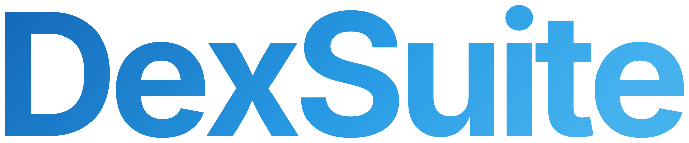
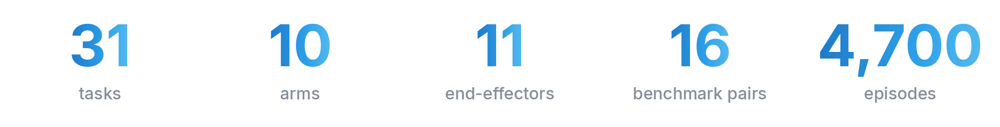
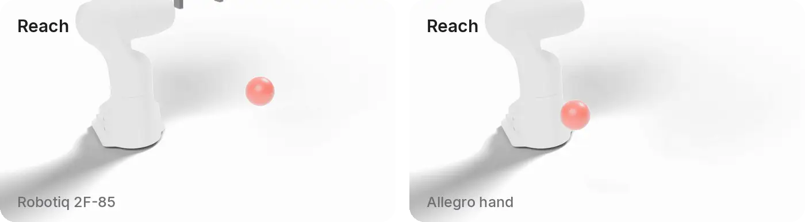
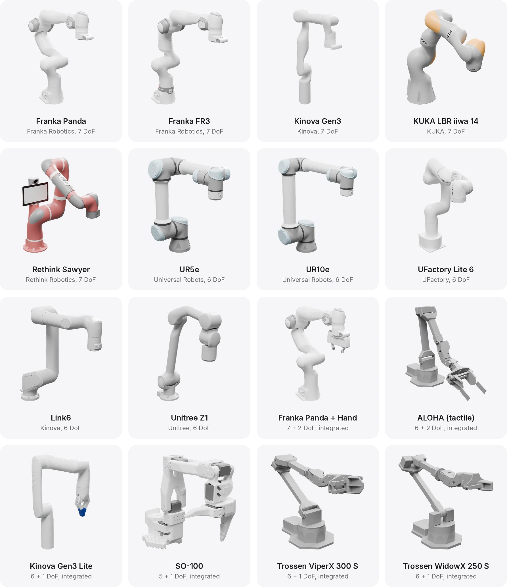
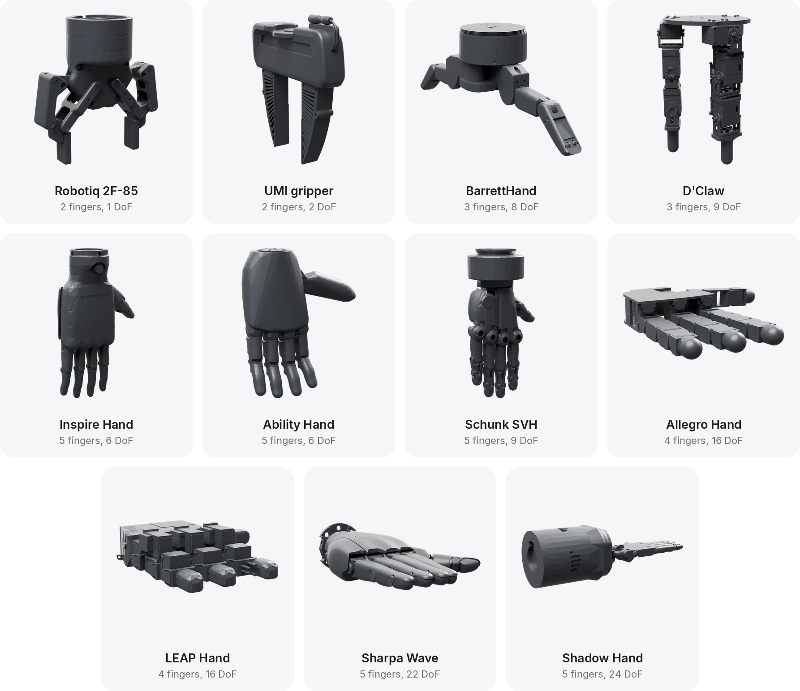
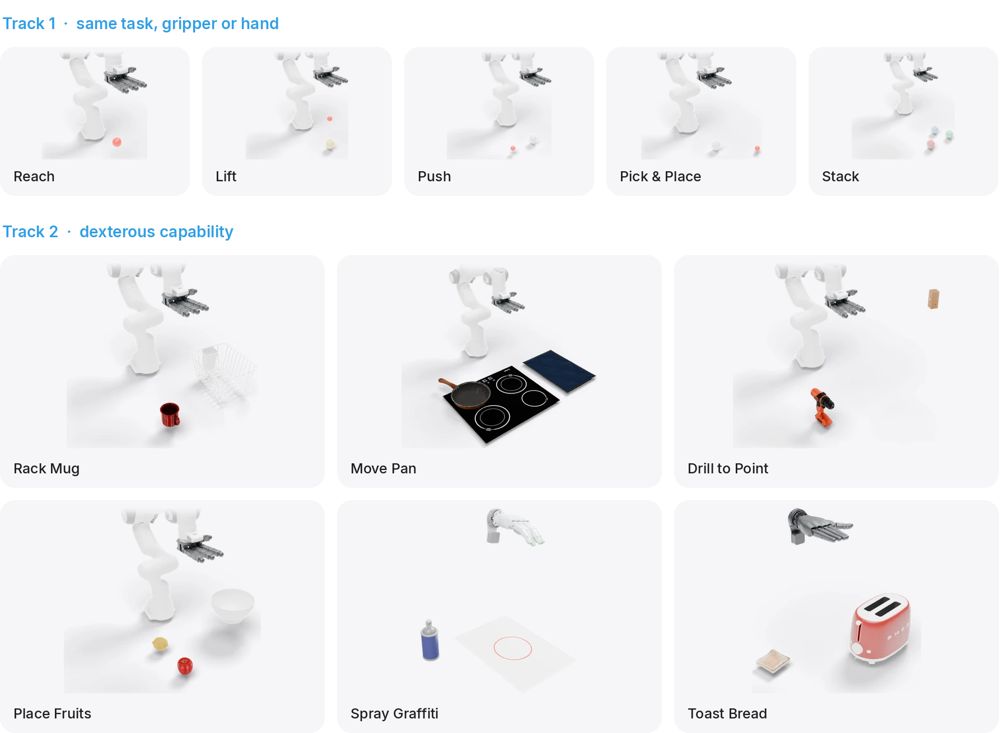
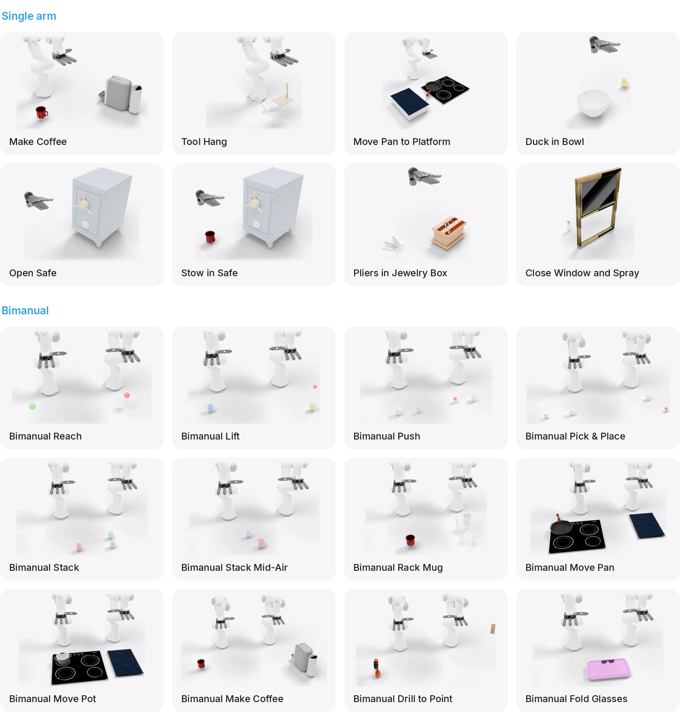
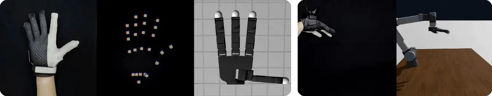
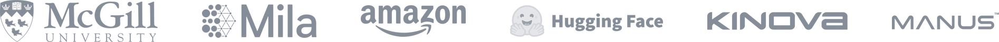

<p align="center">
  
</p>

<h3 align="center">Dexterous manipulation. Simulated, teleoperated, benchmarked.<br>All in one framework.</h3>

<p align="center">
  <a href="https://dexsuiteorg.github.io/"><b>Website</b></a>&nbsp;&nbsp;·&nbsp;&nbsp;
  <a href="https://dexsuite.readthedocs.io/"><b>Documentation</b></a>&nbsp;&nbsp;·&nbsp;&nbsp;
  <a href="https://huggingface.co/dexsuite"><b>Datasets</b></a>&nbsp;&nbsp;·&nbsp;&nbsp;
  <a href="https://arxiv.org/abs/2610.37799"><b>Paper</b></a>
</p>

<p align="center">
  <a href="https://pypi.org/project/dexsuite/"></a>
  
  
  
  
  <a href="https://huggingface.co/dexsuite"></a>
</p>

<p align="center"><sub>DexSuite is in beta: the API may still change before 1.0. Pin the version for reproducible work, and please
<a href="https://github.com/anashoussaini/Dexsuite/issues">open an issue</a> if anything breaks.</sub></p>

<p align="center">
  
</p>

<p align="center">
  
</p>

## Built for real dexterity.

DexSuite brings the robot, the tasks, teleoperation, tactile sensing, the data and the evaluation into one stack. A
task is written once and runs with any arm and any hand, from a parallel-jaw gripper to a 24-joint hand.

```python
import dexsuite as ds

env = ds.make("lift", manipulator="franka", gripper="allegro")
obs, info = env.reset(seed=0)
obs, reward, terminated, truncated, info = env.step(env.action_space.sample())
```

<br>

## Same task. Any embodiment.

Each task is defined once, with the same reset, observations and success check for a gripper and a hand. Every pair
below is a recorded human demonstration from the benchmark.

<p align="center">
  
</p>

Switching the embodiment is one argument:

```python
env = ds.make("pick_place", manipulator="franka", gripper="umi")                    # UMI gripper, 8 actions
env = ds.make("pick_place", manipulator="franka", gripper="allegro")                # Allegro hand, 22 actions
```

<br>

## Every arm. Every hand.

Ten arms and six integrated robots, from the Franka Panda to the SO-100.

<p align="center">
  
</p>

Eleven end-effectors, from a parallel-jaw gripper to the 24-joint Shadow Hand. An adapter file mounts each one on the
arm's flange, and DexSuite builds the controllers, the workspace and the wrist camera around the pair. Both Franka arms
take all of them except the Sharpa hand, which runs on the floating wrist. Every arm takes the Robotiq gripper and the
Allegro hand, and the [compatibility table](https://dexsuite.readthedocs.io/en/latest/robots/compatibility.html) lists the rest.

<p align="center">
  
</p>

```python
env = ds.make("lift", manipulator="ur5", gripper="leap")              # a modular arm and a hand
env = ds.make("lift", manipulator="so_100")                           # an integrated robot, its own gripper
env = ds.make("bimanual_lift", manipulator=("franka", "franka"),
              gripper=("allegro_left", "allegro_right"))              # two arms
env = ds.make("spray_graffiti", manipulator="floating",
              gripper="sharpa")                                       # a hand on its own: 6 wrist + 22 finger actions
```

<br>

## 31 tasks, ready to run.

The benchmark has two tracks. Track 1 holds five tasks that a gripper and a hand can both do, so the two are compared
on equal terms. Track 2 asks for dexterity: lift a pan by its handle, aim a drill, stand a slice of bread in a
toaster, spray a stencil.

<p align="center">
  
</p>

<details>
<summary><b>20 more tasks</b>, single-arm and bimanual</summary>
<br>
<p align="center">
  
</p>
</details>

Every [task page](https://dexsuite.readthedocs.io/en/latest/tasks/index.html) lists the scene, the randomization, the
observations, the success check and the horizon.

<br>

## One call to make. Gymnasium to run.

```python
import dexsuite as ds

env = ds.make(
    "lift",                     # the task
    manipulator="franka",       # the arm
    gripper="allegro",          # the end-effector
    render_mode="human",        # the Genesis viewer, leave it out on a headless machine
)
obs, info = env.reset(seed=0)

for _ in range(300):
    action = env.action_space.sample()       # 6 values move the hand, 16 set the Allegro joints
    obs, reward, terminated, truncated, info = env.step(action)

env.close()
```

- **Batched.** `n_envs=64` builds 64 copies in one simulator. Every tensor gets a leading batch dimension, and a
  finished copy resets inside `step` while the others keep going.
- **Observations.** Proprioception, task state and cameras in one dict. A front and a wrist camera by default, with
  RGB, depth and segmentation.
- **Controllers.** Delta end-effector pose through inverse kinematics by default (`osc_pose`), or absolute poses, joint
  positions, velocities and torques.
- **Tactile.** The UMI gripper carries FlexiTac-sized pads, a 12 by 32 grid of taxels per finger with normal and
  friction forces.
- **Options.** The short form above, or typed options for every part: `RobotOptions`, `SimOptions`, `CamerasOptions`,
  `LayoutOptions`.

<br>

## Install

```bash
pip install dexsuite
```

Python 3.10 or newer and a CUDA GPU; the CPU works for a quick look. This brings Genesis 0.4.3, PyTorch, Mink with its
QP solver and Gymnasium, with every robot and the assets of every task but one: Close Window and Spray runs from a clone,
its window model is over PyPI's file-size limit. To change the code, or for the full object
library, install from source:

```bash
git clone https://github.com/anashoussaini/Dexsuite.git
cd Dexsuite
pip install -e .            # or: uv pip install -e .
```

The first `ds.make` on a machine compiles the Genesis kernels, which takes about a minute. On a machine without a
display, render the cameras through EGL:

```bash
export PYOPENGL_PLATFORM=egl
```

| Extra | Adds |
|---|---|
| `pip install "dexsuite[datasets]"` | LeRobot 0.4.4 and h5py, to record demonstrations and load the datasets |
| `pip install "dexsuite[spacemouse]"` | a 3Dconnexion SpaceMouse |
| `pip install "dexsuite[vive]"` | HTC Vive trackers and controllers, through SteamVR or streamed over ZMQ |
| `pip install "dexsuite[manus]"` | a Manus glove, retargeted to the hand with [GeoRT](https://github.com/facebookresearch/GeoRT) |
| `pip install "dexsuite[all]"` | everything above |

From a clone, the same extras install with `pip install -e ".[datasets]"` and so on.

<br>

## Teleoperation, built in.

Plug in a device and drive any robot. The arm follows a keyboard, a SpaceMouse or an HTC Vive tracker or controller,
and a Manus glove moves the fingers of whichever hand is mounted.

<p align="center">
  
</p>

The interactive builder asks for a task and a robot, then hands you the controls:

```bash
python -m scripts.interactive_builder                       # keyboard by default
python -m scripts.interactive_builder --input spacemouse    # or vive_controller, vive_tracker
```

The browser builder writes the `ds.make` call for you:

```bash
python -m http.server 8000 --bind 127.0.0.1 -d scripts/web_builder
# open http://localhost:8000/env_builder.html
```

The [recording scripts](https://dexsuite.readthedocs.io/en/latest/teleop/recording.html) keep the successful
episodes and write them as a LeRobot dataset, ready to train on or to push to the Hub.

<br>

## 4,700 episodes.

Every one of the 16 benchmark task-embodiment pairs, recorded at 20 Hz with front and wrist cameras, proprioception
and object states. Human teleoperation, a scripted expert and machine-generated demonstrations, in LeRobot format with
an HDF5 export for robomimic.

```python
from lerobot.datasets.lerobot_dataset import LeRobotDataset

data = LeRobotDataset("dexsuite/lift_franka_allegro")
```

<details>
<summary><b>Every dataset</b>, by task and embodiment</summary>
<br>

| Task | Embodiment | Datasets on Hugging Face |
|---|---|---|
| [Reach](https://dexsuite.readthedocs.io/en/latest/tasks/reach.html) | Robotiq gripper | [human](https://huggingface.co/datasets/dexsuite/reach_franka_robotiq) · [generated](https://huggingface.co/datasets/dexsuite/reach_franka_robotiq_mg) |
| [Reach](https://dexsuite.readthedocs.io/en/latest/tasks/reach.html) | Allegro hand | [human](https://huggingface.co/datasets/dexsuite/reach_franka_allegro) · [generated](https://huggingface.co/datasets/dexsuite/reach_franka_allegro_mg) |
| [Lift](https://dexsuite.readthedocs.io/en/latest/tasks/lift.html) | UMI gripper | [human](https://huggingface.co/datasets/dexsuite/lift_franka_franka_umi_tacticle) · [scripted](https://huggingface.co/datasets/dexsuite/lift_franka_franka_umi_tacticle_scripted) · [generated](https://huggingface.co/datasets/dexsuite/lift_franka_franka_umi_tacticle_mg) |
| [Lift](https://dexsuite.readthedocs.io/en/latest/tasks/lift.html) | Allegro hand | [human](https://huggingface.co/datasets/dexsuite/lift_franka_allegro) · [generated](https://huggingface.co/datasets/dexsuite/lift_franka_allegro_mg) |
| [Push](https://dexsuite.readthedocs.io/en/latest/tasks/push.html) | UMI gripper | [human](https://huggingface.co/datasets/dexsuite/push_franka_franka_umi_tacticle) · [scripted](https://huggingface.co/datasets/dexsuite/push_franka_franka_umi_tacticle_scripted) · [generated](https://huggingface.co/datasets/dexsuite/push_franka_franka_umi_tacticle_mg) |
| [Push](https://dexsuite.readthedocs.io/en/latest/tasks/push.html) | Allegro hand | [human](https://huggingface.co/datasets/dexsuite/push_franka_allegro) · [generated](https://huggingface.co/datasets/dexsuite/push_franka_allegro_mg) |
| [Pick & Place](https://dexsuite.readthedocs.io/en/latest/tasks/pick_place.html) | UMI gripper | [human](https://huggingface.co/datasets/dexsuite/pick_place_franka_franka_umi_tacticle) · [scripted](https://huggingface.co/datasets/dexsuite/pick_place_franka_franka_umi_tacticle_scripted) · [generated](https://huggingface.co/datasets/dexsuite/pick_place_franka_franka_umi_tacticle_mg) |
| [Pick & Place](https://dexsuite.readthedocs.io/en/latest/tasks/pick_place.html) | Allegro hand | [human](https://huggingface.co/datasets/dexsuite/pick_place_franka_allegro) · [generated](https://huggingface.co/datasets/dexsuite/pick_place_franka_allegro_mg) |
| [Stack](https://dexsuite.readthedocs.io/en/latest/tasks/stack.html) | UMI gripper | [human](https://huggingface.co/datasets/dexsuite/stack_franka_franka_umi_tacticle) · [scripted](https://huggingface.co/datasets/dexsuite/stack_franka_franka_umi_tacticle_scripted) · [generated](https://huggingface.co/datasets/dexsuite/stack_franka_franka_umi_tacticle_mg) |
| [Stack](https://dexsuite.readthedocs.io/en/latest/tasks/stack.html) | Allegro hand | [human](https://huggingface.co/datasets/dexsuite/stack_franka_allegro) · [generated](https://huggingface.co/datasets/dexsuite/stack_franka_allegro_mg) |
| [Rack Mug](https://dexsuite.readthedocs.io/en/latest/tasks/pick_place_mug.html) | Allegro hand | [human](https://huggingface.co/datasets/dexsuite/pick_place_mug_franka_allegro) · [generated](https://huggingface.co/datasets/dexsuite/pick_place_mug_franka_allegro_mg) |
| [Move Pan](https://dexsuite.readthedocs.io/en/latest/tasks/pick_place_pan.html) | Allegro hand | [human](https://huggingface.co/datasets/dexsuite/pick_place_pan_franka_allegro) · [generated](https://huggingface.co/datasets/dexsuite/pick_place_pan_franka_allegro_mg) |
| [Drill to Point](https://dexsuite.readthedocs.io/en/latest/tasks/drill_to_point.html) | Allegro hand | [human](https://huggingface.co/datasets/dexsuite/drill_to_point_franka_allegro) · [generated](https://huggingface.co/datasets/dexsuite/drill_to_point_franka_allegro_mg) |
| [Place Fruits](https://dexsuite.readthedocs.io/en/latest/tasks/pick_place_fruit.html) | Allegro hand | [human](https://huggingface.co/datasets/dexsuite/pick_place_fruit_franka_allegro) · [generated](https://huggingface.co/datasets/dexsuite/pick_place_fruit_franka_allegro_mg) |
| [Spray Graffiti](https://dexsuite.readthedocs.io/en/latest/tasks/spray_graffiti.html) | Sharpa hand | scripted, coming soon |
| [Toast Bread](https://dexsuite.readthedocs.io/en/latest/tasks/put_bread_toaster.html) | Sharpa hand | scripted, coming soon |

</details>

<br>

## Documentation

- [**Get started**](https://dexsuite.readthedocs.io/en/latest/get-started/index.html): installation, a first environment, the builders
- [**Concepts**](https://dexsuite.readthedocs.io/en/latest/concepts/index.html): `ds.make`, the environment loop, actions, observations, workspaces, parallel environments
- [**Tasks**](https://dexsuite.readthedocs.io/en/latest/tasks/index.html): every task with its scene, observations, success check and horizon
- [**Robots**](https://dexsuite.readthedocs.io/en/latest/robots/index.html): arms, end-effectors and which mounts on which
- [**Teleoperation**](https://dexsuite.readthedocs.io/en/latest/teleop/index.html): devices and recording
- [**Data**](https://dexsuite.readthedocs.io/en/latest/data/index.html): the benchmark datasets, training and evaluation, scripted experts
- [**How-to**](https://dexsuite.readthedocs.io/en/latest/how-to/index.html): add a task, an arm, an end-effector, a camera or tactile pads

## Repository

```
dexsuite/
  environments/     the tasks, single-arm and bimanual, on one BaseEnv
  models/           arms, end-effectors, objects and the arena, with each arm's adapter file
  controllers/      pose and joint controllers
  devices/          keyboard, SpaceMouse, Vive and Manus
  options/          the typed options behind ds.make
  config/           workspaces, layouts, cameras and controllers
  utils/            the LeRobot logger, tactile pads, cameras
scripts/
  interactive_builder/          pick a task and a robot, then teleoperate it
  web_builder/                  the same in a browser, writes the ds.make call
  data_collection/              record demonstrations with each device
  automated_data_collection/    scripted experts for Track 1
  imitation_learning/           robomimic training and evaluation on the datasets
tests/
```

## Contributing

New tasks, robots and fixes are welcome. [CONTRIBUTING.md](CONTRIBUTING.md) covers the setup, the checks and how to
add a task or a robot. Found a bug? Open an [issue](../../issues).

## Citation

```bibtex
@article{houssaini2026dexsuite,
  title   = {DexSuite: An All-in-One Framework for Dexterous Manipulation Across Arms, Hands, and Tasks},
  author  = {Houssaini, Anas and He, Hugo and Shi, Junming and Abyaneh, Amin and Chahine, Ricardo and Wen, Shuo and Danesh, Mohamad H. and Fr{\'e}chette, Charles-{\'E}tienne and Sosa Guzman, Mariana and Desrochers, Mathias and Houssaini, Rayan and Landa, Adam and Soulie, Theophile and Morissette, Charlotte and Tims, Annie and Russi, Martino and Lussier, Jonathan and Dudek, Gregory and Precup, Doina and Urain, Julen and Lin, Hsiu-Chin and Meger, David},
  journal = {arXiv preprint arXiv:2610.37799},
  year    = {2026}
}
```

## License

The DexSuite code is released under the [MIT License](LICENSE). The robot, hand and object models in
`dexsuite/models` keep their own licences, listed in [THIRD_PARTY_LICENSES.md](THIRD_PARTY_LICENSES.md). Some objects
(the PartNet-Mobility models) are for non-commercial research and education only. The ACT policy in
`scripts/imitation_learning/robomimic` adapts code from ACT (MIT) and DETR (Apache-2.0), also listed there.

## Acknowledgements

DexSuite runs on [Genesis](https://github.com/Genesis-Embodied-AI/Genesis). Most robot and hand models come from
[MuJoCo Menagerie](https://github.com/google-deepmind/mujoco_menagerie).

<p align="center">
  <br>
  
</p>
